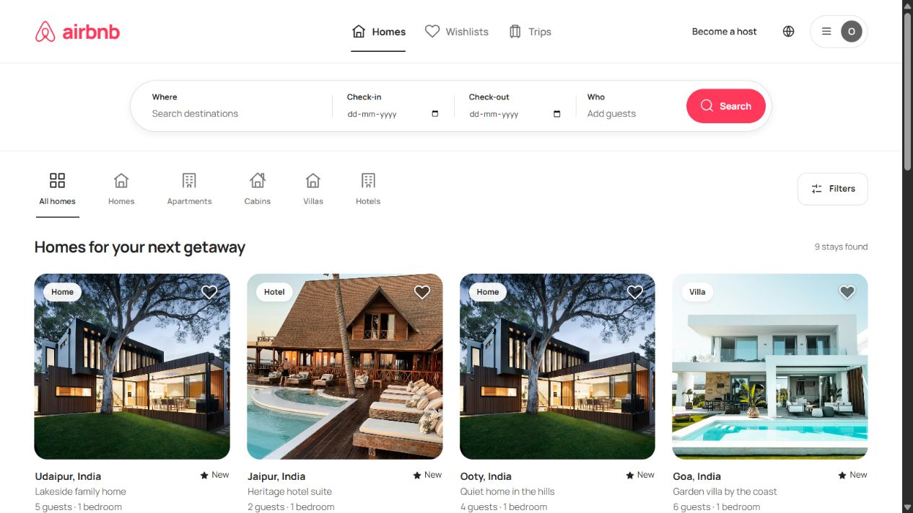

# Airbnb Clone

A full-stack accommodation booking platform with guest accounts, property hosting, availability search, reservations, reviews and secure checkout integration. Built with **Node.js, Express, MongoDB, Mongoose, EJS and custom HTML/CSS**.



## Features

- Account registration, login/logout and persistent server sessions.
- Profile management, password changes and expiring password recovery links.
- Property creation and owner-authorized editing, removal and photo uploads.
- Guest capacity, bedroom/bathroom counts, property categories and amenities.
- Location/title search, price/type/guest/availability filters, sorting and pagination.
- Saved properties, guest trip management and a host reservation dashboard.
- Server-calculated pricing, transactional reservations and overlap prevention.
- Razorpay checkout, payment verification, repeat-submission protection and payment reversal handling.
- Future reservation cancellation with immediate availability updates.
- Verified-stay reviews with author-only updates/removal and average ratings.
- Airbnb-inspired responsive design with a rounded search bar, account menu, photo-first cards and mobile navigation.
- Calendar date-range selection, guest steppers, filter dialogs and instant wishlist feedback.
- Photo galleries with keyboard navigation, share links, live price previews and an embedded area map.
- Consistent hosting, account, trip, editor, checkout and receipt interfaces with loading and error states.

## Requirements

- Node.js 20.19 or newer; Node.js 24 recommended.
- MongoDB Atlas or a MongoDB replica set. Multi-document transactions are required.
- SMTP access for password recovery email delivery.
- Razorpay test API keys to enable online checkout.

## Installation

```text
npm ci
```

Copy `.env.example` to `.env`, configure the database and session secret, then start the server:

```text
npm start
```

For development with automatic restarts:

```text
npm run dev
```

Open `http://localhost:3000`. Create a host account, add a property, then use a separate account/browser profile to book it.

### Database configuration

Atlas supports the transactions used by reservations, cancellation, property archival and image updates. For local MongoDB, initialize a replica set named `rs0` and use a connection such as:

```text
mongodb://127.0.0.1:27017/airbnb_clone?replicaSet=rs0
```

A standalone MongoDB instance does not support these operations. The server waits for the database and required unique indexes before accepting requests.

### Environment variables

| Variable | Description |
| --- | --- |
| `MONGODB_URI` | Atlas or replica-set connection string |
| `SESSION_SECRET` | Unique random secret of at least 32 characters |
| `PORT` | HTTP port; default `3000` |
| `NODE_ENV` | `development` or `production` |
| `APP_URL` | Application base URL; used in recovery emails |
| `TRUST_PROXY` | Set `1` only behind one trusted reverse proxy |
| `SMTP_HOST`, `SMTP_PORT` | Mail server; port `465` enables TLS |
| `SMTP_USER`, `SMTP_PASSWORD`, `MAIL_FROM` | Mail authentication and sender |
| `RAZORPAY_KEY_ID`, `RAZORPAY_KEY_SECRET` | Razorpay test-mode key pair |

Keep `.env` private. The repository includes only an empty configuration example. Production requires a session secret and HTTPS; configure the trusted proxy explicitly when applicable. A temporary key is allowed only during development and invalidates sessions on restart.

## Payments

Online checkout uses Razorpay Standard Checkout with server-created orders. The server validates the callback signature, fetches payment details, checks the order/currency/amount and confirms capture before creating the reservation. If the selected dates or price change before reservation confirmation, the integration requests a reversal. Successful reservation callbacks are idempotent.

The integration currently accepts **Razorpay test-mode keys only** (`rzp_test_`). Live keys are rejected. Generate your own keys from [Razorpay API settings](https://razorpay.com/docs/payments/dashboard/account-settings/api-keys/) and add them to the private environment file. Card information stays within Razorpay checkout. Test-payment status appears on the secure checkout and financial receipt pages.

Without payment credentials, guests can confirm reservations without an online payment; the receipt accurately shows **Not collected**. A reservation is never presented as paid merely because it was created. Zero-price reservations skip online payment.

A configured payment reserves dates only after verification. If verification/reversal is interrupted, retry the verification flow; failed reversals remain pending. This integration uses synchronous verification and retry handling rather than asynchronous payment webhooks. A live-money rollout requires provider activation, webhook reconciliation, operational refund monitoring and a separate production review.

## Accounts and ownership

Passwords use salted scrypt hashes. MongoDB stores the authenticated session. Login rotates the session ID, and password changes/resets revoke older sessions. Recovery links expire after 30 minutes and can be used once. Without SMTP configuration, the recovery form reports that email delivery is unavailable; registration and login continue to work.

Only the property owner can edit, remove or upload images to a listing. Existing properties without an owner remain visible but are protected from management and booking until explicitly assigned.

After creating the intended host account, preview ownership assignment:

```text
npm run assign-listings -- --email YOUR_ACCOUNT_EMAIL
```

Append `--apply` to assign only unowned properties. Existing ownership is preserved. To add an initial property collection without replacing current data:

```text
npm run seed -- --email YOUR_ACCOUNT_EMAIL
```

## Reservation rules

- Prices use INR and integer paise for calculations.
- Choose 1–90 nights with check-in within one year.
- Dates represent midnight UTC; the checkout date is not an occupied night.
- Guest count cannot exceed the property's capacity.
- A unique property/date index prevents overlapping reservations inside a transaction.
- A changed price requires reviewing a fresh quote.
- Guests may cancel before the check-in date. Cancelled nights become available again.
- Property removal archives the listing and retains reservation history. Upcoming or active stays prevent removal.
- A guest must complete a confirmed stay before reviewing. Hosts cannot review their own properties.
- Saved properties are limited to 200 per account. The host dashboard displays the latest 100 reservations.

## Photos

Upload a JPEG, PNG or WebP cover photo of up to 5 MB from the property edit page, or supply an external HTTP/HTTPS URL. Add up to four additional image URLs to build a five-photo gallery. Uploads are checked by file signature and stored in MongoDB. Leaving the URL blank during editing keeps the existing photo. The property-type image option selects a bundled photograph.

Bundled photographs are stored under `public/images/stays/` and remain available without an external image request. See [image credits](docs/image-credits.md) for sources and licensing.

To enrich only the prepared properties that do not already have galleries, add `--add-photos` to the seed command. Existing host galleries and the original properties are preserved.

The interface uses a locally hosted Manrope font under the SIL Open Font License; the license is included in `public/fonts/OFL.txt`. Icons are lightweight inline SVGs. The help center explains the app’s actual booking, account, hosting and payment behavior.

## Verification

```text
npm test
npm audit
```

The test suite starts an isolated MongoDB replica set and does not change the application database. It covers account flows, authorization, CSRF, validation, search, pagination, favorites, uploads, reservation races, pricing changes, cancellation, verified reviews, password recovery, session persistence and payment verification/reversal behavior. Provider calls are mocked; completing a provider transaction requires your configured test account.

The first test run downloads MongoDB 8.0.17, which is a large download on Windows. Later runs use the cache. `MONGOMS_SYSTEM_BINARY` can point to a compatible installed `mongod` binary instead.

See the [acceptance checklist](docs/submission-checklist.md) for a complete browser walkthrough.

## Architecture

| Location | Responsibility |
| --- | --- |
| `app.js` | Middleware, security headers, sessions, startup and error handling |
| `routes/auth.js` | Registration, authentication, account and recovery flows |
| `routes/stays.js` | Properties, search, favorites, trips, hosting and reviews |
| `routes/payments.js` | Payment orders, verification and reversal handling |
| `lib/booking.js` | Dates, pricing and transactional reservation operations |
| `lib/security.js` | Password hashing, session helpers and authorization |
| `lib/payments.js` | Razorpay API adapter and signature verification |
| `models/` | Users, listings, bookings, nightly availability, reviews, photos and payment attempts |
| `views/`, `public/` | Server-rendered pages, custom styles and static assets |
| `scripts/` | Ownership migration and initial property collection |
| `test/` | Unit and MongoDB integration tests |

## Deployment

Configure HTTPS, a stable session secret, Atlas, the public application URL and SMTP. Set `NODE_ENV=production` and configure `TRUST_PROXY` only for the actual proxy topology. The application does not automatically publish a deployment.

The current implementation uses per-process request rate limits. Multi-instance hosting requires a shared limiter and operational monitoring. Additional roadmap items include email verification, social login, messaging, administrative moderation and account/data-retention controls.

## Completing a Razorpay sandbox payment

Select Cards, enter the official test card 4100 2800 0000 1007, any CVV and a future expiry date. On the test bank page choose Success; if an OTP is requested, enter 123456. Do not use real card details. Confirm the resulting payment under Test mode in the Razorpay dashboard. Failed or abandoned authentication does not confirm a reservation. The checkout page includes these steps and supports reopening after dismissal or a loading failure. Provider availability and bank authentication still determine whether a sandbox attempt succeeds.

Reference: https://razorpay.com/docs/payments/payments/test-card-details/

